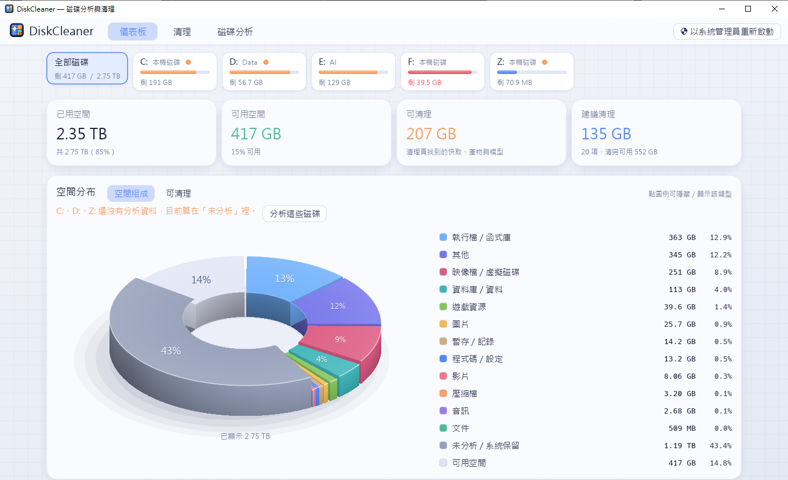
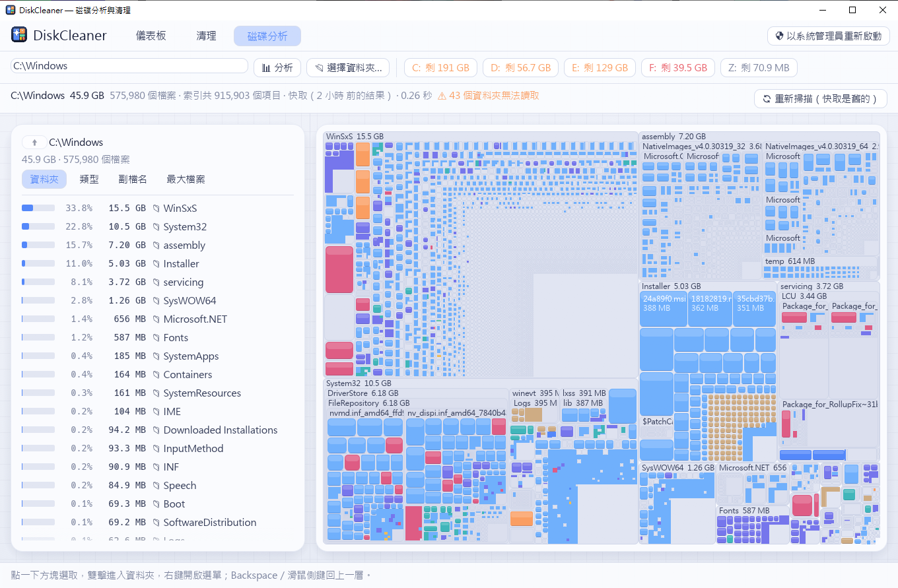
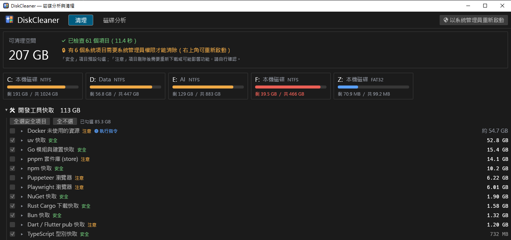

# DiskCleaner


**English** · [繁體中文](README.zh-TW.md)

[](LICENSE) [](#build) [](https://www.rust-lang.org) [](https://github.com/ailazytech/disk-cleaner/actions/workflows/ci.yml)

> **See what's eating your drives — then clear it in one go.**

A fast disk analyzer and cleaner for Windows, written in Rust with egui. It shows what fills each drive as a treemap, and digs out what developers pile up over time: package-manager caches, `node_modules` / `target` / `.venv` folders, temp files, Windows Update leftovers and multi-gigabyte AI models.

- One `.exe`, no installer, Windows 10 / 11
- No network access at all — nothing leaves your computer
- The UI is in Traditional Chinese for now (an English UI is not available yet)







## Features

### Dashboard

- A matte 3D donut chart of where your space goes, switchable between **space composition** (videos, images, code, executables… plus free space) and **cleanable** (dev caches, temp files, build artifacts, AI models…)
- Filter by drive; click a legend entry to hide or show a type
- A **suggested cleanup** list: only Safe caches, build artifacts untouched for 7+ days, and duplicate model files — hover a row to see why it is safe to remove

### Clean

| Category | What it finds |
|---|---|
| Dev tool caches | npm, pnpm store, Yarn, Bun, Deno, Cargo registry, rustup downloads, sccache, pip, uv, Poetry, Conda, Gradle, Maven, NuGet, Go, Composer, pub, Playwright, Puppeteer, Cypress, Electron, node-gyp, vcpkg, JetBrains, Docker (`system prune`) |
| System temp files | `%TEMP%` (only files older than 1 day), `Windows\Temp`, error reports, crash dumps, thumbnail cache, GPU shader caches, Delivery Optimization, CBS/DISM logs |
| Windows Update & installers | `SoftwareDistribution\Download`, `Windows.old`, upgrade folders, driver extraction folders, Package Cache, DISM component cleanup, hibernation file, old installers in Downloads |
| Browsers & apps | Chrome, Edge, Brave, Vivaldi, Opera, Firefox, Electron apps (Discord, VS Code, Slack, Teams…), VS Code / Cursor logs, Steam, Adobe media cache, Spotify |
| Recycle Bin | All drives |

Every item is marked **Safe** (a pure cache that rebuilds itself) or **Caution** (needs a re-download, or may affect a feature). Safe items are pre-selected; Caution items are not.

### Project build artifacts

Searches your folders for `node_modules`, Rust `target`, Python virtual environments and `__pycache__`, `.next` / `.nuxt` / `.turbo`, Gradle / Flutter / .NET / CMake / Unity / Unreal build output, and any folder with a `CACHEDIR.TAG`.

A folder is listed only when the matching project marker is there (`package.json`, `Cargo.toml`, `pyvenv.cfg`, `*.csproj`, …). Each row shows when the newest file inside was modified, so you can clear out projects you haven't touched in months.

### AI models

- Hugging Face hub — one row per model or dataset
- Ollama — reads the manifests (honors `OLLAMA_MODELS`); deleting a model removes only the blobs no other model uses
- LM Studio, ComfyUI, PyTorch hub, Whisper, Jan, GPT4All, InsightFace, ModelScope…
- Any `.safetensors` / `.gguf` / `.ckpt` / `.pt` / `.pth` / `.onnx` file of 50 MB or more in your search folders
- Duplicates (same name and size) are flagged; **select duplicates** keeps the newest copy of each, and each one is compared byte for byte with the kept copy before it is deleted

Models are never pre-selected.

### Disk analyzer

- Squarified treemap colored by file type; double-click to zoom in, Backspace or the mouse back button to go up
- Folder list, file-type breakdown, extensions, the 500 largest files
- Right-click: show in Explorer, copy path, move to Recycle Bin, delete permanently
- Drag a folder onto the window to analyze it

## Why it's fast

| Method | When | How |
|---|---|---|
| NTFS MFT read *(experimental)* | Administrator + NTFS | Reads the whole `$MFT` sequentially and parses the file records itself — no folder-by-folder enumeration |
| USN journal update *(experimental)* | Administrator + NTFS + an earlier index | Re-reads only the records changed since the last scan |
| Parallel directory walk | Everything else | `FindFirstFileExW` with large fetch, one rayon task per folder |
| Result cache | Always | Scans are saved as lz4-compressed indexes; the clean page shows the last results immediately and refreshes them in the background |

On the author's machine a full walk without administrator rights runs at about 120,000 items per second, and reopening a cached index of 2.6 million items takes about 0.4 seconds.

> The MFT / USN path falls back to the directory walk automatically if anything goes wrong. It stays marked experimental until it has had more real-world testing — reports are welcome.

## Safety

Wrongly deleting your data is the worst thing a cleaner can do, so the deletion code is written to fail closed:

- Never follows junctions or symlinks: if a target — or any folder on its path — is a link, it is skipped; links found inside are removed as links only
- Deletion never goes through path strings: starting at the drive root, each folder is opened relative to the handle of its parent (without following links) and held open, folders are listed through their handles, and each item is checked and deleted through its own handle. A folder that gets renamed, swapped, or turned into a junction in place mid-delete still only exposes its original contents
- Protected paths are checked after normalizing the path (`/`, `..`, trailing separators, drive-relative paths) **and** after resolving links and 8.3 short names: drive roots, every user profile under `Users`, Documents / Desktop / Downloads (even if moved to another drive), Windows and its system folders (System32, WinSxS…), Program Files, ProgramData, the AppData roots, `$Recycle.Bin`, `System Volume Information`
- Results shown from the cache are never used to delete: each rule is measured again right before cleaning, and each build artifact is re-detected and skipped if anything in it changed since the scan
- A folder that contains `.git` / `.hg` / `.svn`, or a project file such as `Cargo.toml` / `CMakeLists.txt`, is never treated as a build artifact; `CACHEDIR.TAG` must carry the real signature; a venv is recognised as a venv whatever it is called
- Duplicate models are compared byte for byte against the copy being kept, through locked handles that are also used for the delete; both must be regular, different files
- Ollama: models are only removed while Ollama is not running; manifest digests must look like `sha256:<hex>`, blobs are only removed from the `blobs` folder, and nothing is removed unless every other manifest can be listed, read and fully understood
- Files in use are skipped; cloud placeholders (OneDrive) are never deleted; with an age limit, recently created folders are kept; files with other hard links don't count as freed space
- **Move to Recycle Bin** goes through the same checks as permanent delete (including cloud files anywhere inside a folder) and asks before permanently deleting something that can't be recycled; the analyzer refuses to delete stale cached data, or anything created or modified after the scan, until you rescan
- Clean rules delete permanently (that is how space gets freed)
- `disk-cleaner.exe --selftest` runs 76 checks in a scratch folder (junctions, a folder turned into a junction in place mid-clean, folders held open against renaming, 8.3 short names, hard links, simulated cloud files, read-only files, protected-path aliases, fake projects, a fake Ollama store with malicious and half-written manifests, look-alike model files, synthetic MFT records…); CI runs it on every push

The deletion code was reviewed by two independent AI reviewers (OpenAI Codex and Google Gemini) before release, and the fixes went through two more review rounds; the issues found are fixed and covered by the self-test.

## Build

There is no prebuilt release yet. You need Rust 1.92 or newer with the MSVC toolchain:

```
git clone https://github.com/ailazytech/disk-cleaner
cd disk-cleaner
cargo build --release
target\release\disk-cleaner.exe
```

For the MFT fast path and system items (Windows Update, `Windows\Temp`…), click **以系統管理員重新啟動** (*restart as administrator*) in the top-right corner.

## Command line

```
disk-cleaner.exe                               open the GUI
disk-cleaner.exe D:\Projects                   open and analyze a folder
disk-cleaner.exe --rules                       print what each clean rule would free (deletes nothing)
disk-cleaner.exe --projects C:\Users\me D:\    find build artifacts and AI models (deletes nothing)
disk-cleaner.exe --bench C:\ [cache]           scan benchmark
disk-cleaner.exe --bench-delete [N] [flat]     deletion benchmark (only deletes files it creates in %TEMP%)
disk-cleaner.exe --selftest                    safety self-test in a scratch folder
```

## Data and privacy

DiskCleaner makes no network requests. Everything it keeps lives in `%LOCALAPPDATA%\DiskCleaner`:

- `cache\*.idx` — scan indexes (you can clear them from the analyzer start page)
- `rules.cache`, `projects.cache` — the last results of the clean page
- `settings.txt` — your search folders

## Source layout

| File | Purpose |
|---|---|
| `src/win.rs` | Win32 wrappers: directory listing, drives, elevation, Recycle Bin |
| `src/scan.rs` | Parallel directory walk and folder sizing |
| `src/mft.rs` | NTFS MFT reader and USN journal updates |
| `src/index.rs`, `src/cache.rs` | Picks the fastest scan method; lz4 index cache |
| `src/tree.rs`, `src/treemap.rs` | Flat scan tree, statistics, squarified layout |
| `src/rules.rs`, `src/cleaner.rs` | Clean rules, sizing and deletion |
| `src/projects.rs`, `src/models.rs` | Build artifact and AI model detection |
| `src/app.rs`, `src/ui_*.rs` | egui interface (dashboard, clean, analyzer) |
| `src/theme.rs`, `src/pie3d.rs` | Matte theme and the 3D donut chart |
| `src/suggest.rs`, `src/summary.rs` | Suggested-cleanup logic; per-drive space summaries |
| `examples/gen_icon.rs` | Generates `assets/icon.ico` (`cargo run --example gen_icon`) |
| `tools/` | Screenshot / click helpers and the elevated MFT benchmark |

## License

[MIT](LICENSE)
