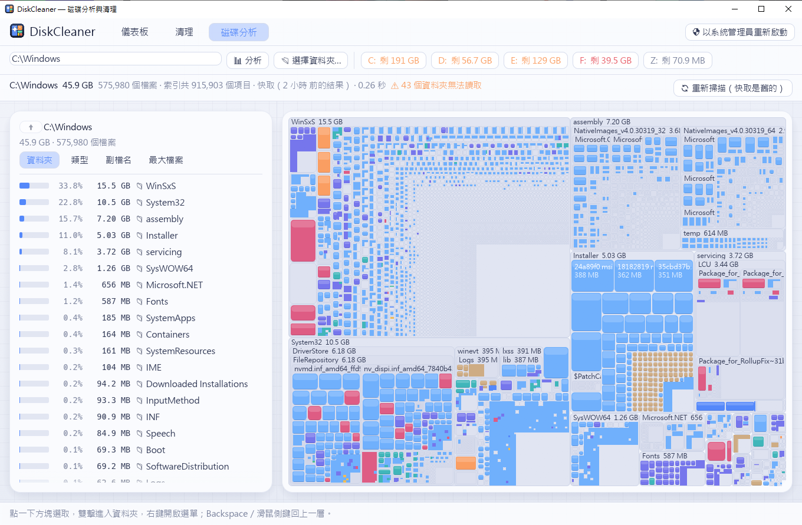
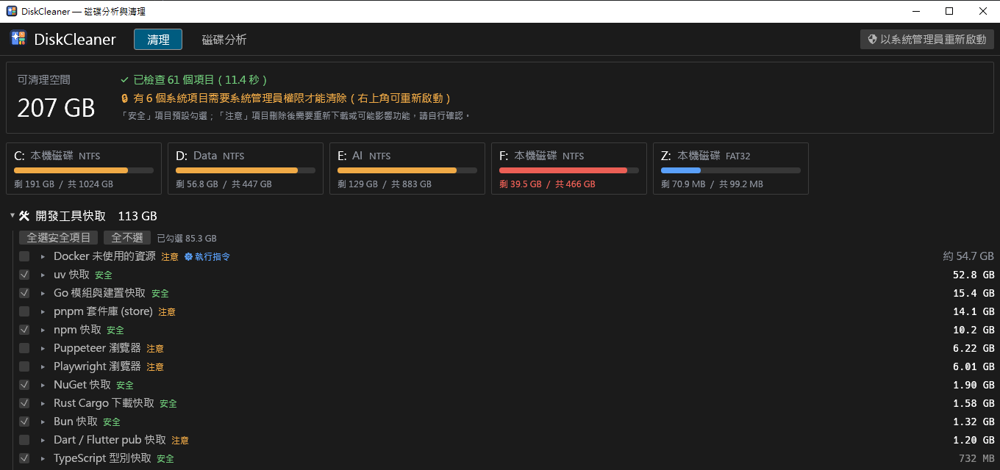

# DiskCleaner


[English](README.md) · **繁體中文**

[](LICENSE) [](#建置) [](https://www.rust-lang.org) [](https://github.com/ailazytech/disk-cleaner/actions/workflows/ci.yml)

> **看清楚磁碟被什麼吃掉，再一次清乾淨。**

用 Rust（egui）寫的 Windows 磁碟分析與清理工具。用 treemap 呈現每顆磁碟裡裝了什麼，並把開發者日積月累的東西撈出來：套件管理器快取、`node_modules`／`target`／`.venv`、暫存檔、Windows Update 殘留，以及動輒數十 GB 的 AI 模型。

- 單一 `.exe`，免安裝，Windows 10／11
- 完全不連網，資料不會離開你的電腦
- 介面目前是繁體中文






## 功能

### 儀表板

- 霧面 3D 甜甜圈圖顯示空間都用在哪裡，可切換 **空間組成**（影片、圖片、程式碼、執行檔…加上可用空間）和 **可清理**（開發快取、暫存檔、建置產物、AI 模型…）
- 可依磁碟篩選；點圖例可以隱藏／顯示某個類型
- **建議清理** 清單：只列「安全」的快取、7 天以上沒動的建置產物、重複的模型檔；滑鼠移到每一列可以看為什麼可以清

### 清理

| 類別 | 會找出的東西 |
|---|---|
| 開發工具快取 | npm、pnpm store、Yarn、Bun、Deno、Cargo registry、rustup 下載暫存、sccache、pip、uv、Poetry、Conda、Gradle、Maven、NuGet、Go、Composer、pub、Playwright、Puppeteer、Cypress、Electron、node-gyp、vcpkg、JetBrains、Docker（`system prune`） |
| 系統暫存檔 | `%TEMP%`（只清 1 天以前的檔案）、`Windows\Temp`、錯誤報告、當機傾印、縮圖快取、顯示卡著色器快取、傳遞最佳化、CBS／DISM 記錄檔 |
| 系統更新與安裝殘留 | `SoftwareDistribution\Download`、`Windows.old`、升級暫存、驅動程式解壓縮檔、Package Cache、DISM 元件清理、休眠檔、下載資料夾裡的舊安裝檔 |
| 瀏覽器與應用程式 | Chrome、Edge、Brave、Vivaldi、Opera、Firefox、Electron 應用（Discord、VS Code、Slack、Teams…）、VS Code／Cursor 記錄、Steam、Adobe 媒體快取、Spotify |
| 資源回收筒 | 所有磁碟 |

每個項目都標示 **安全**（純快取，會自動重建）或 **注意**（刪了要重新下載，或可能影響功能）。「安全」預設勾選，「注意」不勾。

### 專案建置產物

在你指定的資料夾裡搜尋 `node_modules`、Rust `target`、Python 虛擬環境與 `__pycache__`、`.next`／`.nuxt`／`.turbo`、Gradle／Flutter／.NET／CMake／Unity／Unreal 建置輸出，以及含有 `CACHEDIR.TAG` 的資料夾。

一定要找到對應的專案標記（`package.json`、`Cargo.toml`、`pyvenv.cfg`、`*.csproj`…）才會列出。每一列會顯示裡面最新檔案的修改時間，好幾個月沒動的專案一眼就看得出來。

### AI 模型

- Hugging Face hub：逐一列出每個模型與資料集
- Ollama：讀取 manifest（支援 `OLLAMA_MODELS`）；刪除模型時只刪沒有其他模型共用的 blob
- LM Studio、ComfyUI、PyTorch hub、Whisper、Jan、GPT4All、InsightFace、ModelScope…
- 搜尋位置中 50 MB 以上的 `.safetensors`／`.gguf`／`.ckpt`／`.pt`／`.pth`／`.onnx`
- 同名同大小的重複檔會標出來；**只選重複的** 會每組保留最新的一份，刪除前每一份都會和保留的那份逐位元組比對

模型一律不預設勾選。

### 磁碟分析

- 依檔案類型上色的 squarified treemap；雙擊進入資料夾，Backspace 或滑鼠側鍵回上一層
- 資料夾清單、類型分布、副檔名統計、前 500 大檔案
- 右鍵：在檔案總管中顯示、複製路徑、移到資源回收筒、永久刪除
- 把資料夾拖進視窗就會開始分析

## 為什麼快

| 方式 | 條件 | 做法 |
|---|---|---|
| NTFS MFT 直接讀取（實驗性） | 系統管理員 + NTFS | 循序讀完整個 `$MFT` 並自行解析檔案紀錄，不必逐一列舉資料夾 |
| USN 日誌增量更新（實驗性） | 系統管理員 + NTFS + 已有索引 | 只重讀上次掃描之後有變動的紀錄 |
| 平行目錄列舉 | 其他情況 | `FindFirstFileExW` + LARGE_FETCH，每個資料夾一個 rayon 工作 |
| 結果快取 | 任何情況 | 掃描結果存成 lz4 壓縮的索引；清理頁開啟時先顯示上次的結果，再於背景更新 |

在作者的電腦上，一般權限的完整列舉大約每秒 12 萬個項目；重新開啟 260 萬個項目的快取索引約 0.4 秒。

> MFT／USN 路徑出錯時會自動退回目錄列舉。在累積更多實機測試之前先標為實驗性，歡迎回報結果。

## 安全設計

清理工具最糟的情況就是刪錯資料，所以刪除的程式一律採「拿不準就不刪」：

- 不跟隨 junction／symlink：目標本身或路徑上任何一層是連結就略過；裡面遇到的連結只移除連結本身
- 刪除是透過 handle 而不是路徑：從磁碟根目錄到要刪的項目，每一層資料夾都以「不跟隨連結」的方式打開並一直握著（刪除途中沒有程式能把它改名或換成 junction），每個項目也是用同一個 handle 確認後再刪
- 受保護的位置會先正規化路徑（`/`、`..`、結尾斜線、磁碟機相對路徑），**再**解析連結與 8.3 短檔名後各檢查一次：磁碟根目錄、`Users` 底下每一個帳號、文件／桌面／下載（搬到別的磁碟也認得）、Windows 與系統資料夾（System32、WinSxS…）、Program Files、ProgramData、AppData 根目錄、`$Recycle.Bin`、`System Volume Information`
- 快取顯示的結果不會直接拿來刪：清理前每條規則都會重新測量，每個建置產物都會重新偵測一次；掃描之後裡面有任何變動就略過
- 含 `.git`／`.hg`／`.svn`，或直接放著 `Cargo.toml`／`CMakeLists.txt` 之類專案檔的資料夾，絕不當成建置產物；`CACHEDIR.TAG` 必須是正確的簽章；虛擬環境不管叫什麼名字都認得出來
- 重複的模型在刪除前，會和保留的那份逐位元組比對（而且必須是兩個不同的實體檔案）
- Ollama：manifest 的 digest 必須是 `sha256:<十六進位>` 格式，只會刪 `blobs` 資料夾裡的檔案，其他模型的 manifest 只要有一個列不出來、讀不到或內容不完整，就整個不刪
- 使用中的檔案會略過；雲端佔位檔（OneDrive）一律不刪；有時間條件時，最近建立的資料夾會保留；有其他硬連結的檔案不計入釋放空間
- **移到資源回收筒** 和永久刪除走同一套檢查，遇到無法回收的檔案會先詢問，不會靜默永久刪除；分析頁顯示的是快取舊資料時，要先重新掃描才能刪
- 清理規則是永久刪除（這樣才會真正釋放空間）
- `disk-cleaner.exe --selftest` 會在暫存資料夾跑 63 項檢查（junction、握住期間不能被改名的資料夾、硬連結、唯讀檔、受保護路徑的各種別名、假專案、含惡意或寫到一半 manifest 的假 Ollama 模型庫、同名同大小但內容不同的模型檔、模擬的 MFT 紀錄…）；CI 每次 push 都會跑

刪除相關的程式碼在發佈前經過兩個獨立的 AI 審查（OpenAI Codex 與 Google Gemini），修正後又做了第二輪審查；找到的問題都已修正並加進自我測試。

## 建置

目前還沒有預先編譯好的版本。需要 Rust 1.92 以上與 MSVC 工具鏈：

```
git clone https://github.com/ailazytech/disk-cleaner
cd disk-cleaner
cargo build --release
target\release\disk-cleaner.exe
```

要使用 MFT 極速掃描與系統項目（Windows Update、`Windows\Temp`…）的清理，請按右上角的 **以系統管理員重新啟動**。

## 命令列

```
disk-cleaner.exe                               開啟 GUI
disk-cleaner.exe D:\Projects                   開啟並直接分析該資料夾
disk-cleaner.exe --rules                       列出各清理規則可釋放的大小（不刪除）
disk-cleaner.exe --projects C:\Users\me D:\    搜尋專案建置產物與 AI 模型（不刪除）
disk-cleaner.exe --bench C:\ [cache]           掃描效能測試
disk-cleaner.exe --selftest                    在暫存資料夾做安全性自我測試
```

## 資料與隱私

DiskCleaner 不會發出任何網路請求。它保存的東西都在 `%LOCALAPPDATA%\DiskCleaner`：

- `cache\*.idx`：掃描索引（可在分析頁首頁清除）
- `rules.cache`、`projects.cache`：清理頁上次的結果
- `settings.txt`：你的搜尋位置

## 程式結構

| 檔案 | 用途 |
|---|---|
| `src/win.rs` | Win32 包裝：目錄列舉、磁碟、權限、資源回收筒 |
| `src/scan.rs` | 平行目錄列舉與資料夾大小計算 |
| `src/mft.rs` | NTFS MFT 讀取與 USN 日誌增量更新 |
| `src/index.rs`、`src/cache.rs` | 選擇最快的掃描方式；lz4 索引快取 |
| `src/tree.rs`、`src/treemap.rs` | 扁平掃描樹、統計、squarified 版面 |
| `src/rules.rs`、`src/cleaner.rs` | 清理規則、大小計算與刪除 |
| `src/projects.rs`、`src/models.rs` | 建置產物與 AI 模型偵測 |
| `src/app.rs`、`src/ui_*.rs` | egui 介面（儀表板、清理、磁碟分析） |
| `src/theme.rs`、`src/pie3d.rs` | 霧面主題與 3D 甜甜圈圖 |
| `src/suggest.rs`、`src/summary.rs` | 建議清理的判斷；各磁碟的空間摘要 |
| `examples/gen_icon.rs` | 產生 `assets/icon.ico`（`cargo run --example gen_icon`） |
| `tools/` | 截圖／點擊輔助腳本，以及以系統管理員執行的 MFT 效能測試 |

## 授權

[MIT](LICENSE)
